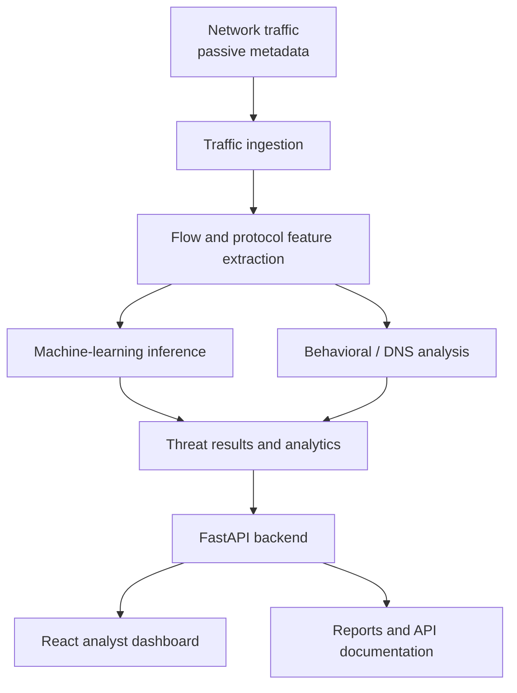
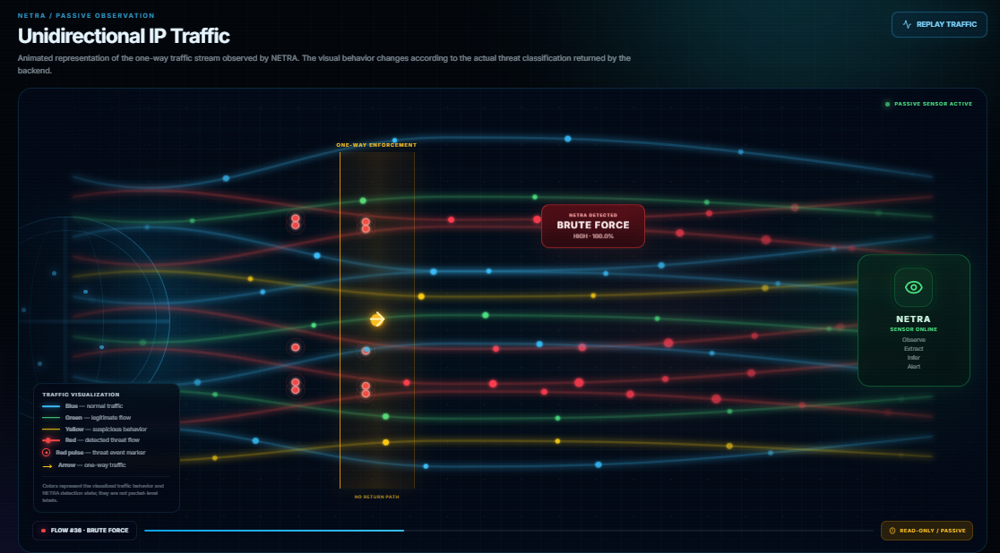
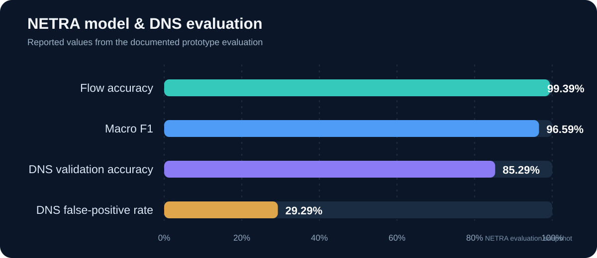
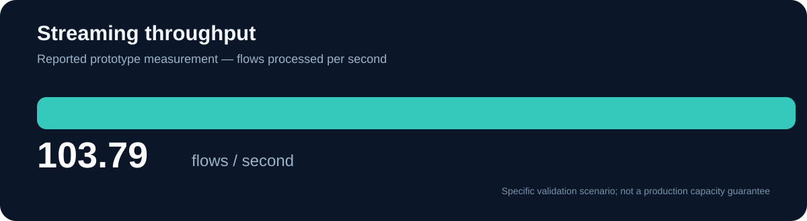

<div align="center">


# NETRA — Network Threat Recognition & Analytics

### AI-assisted passive network threat detection for unidirectional IP traffic

[](https://www.python.org/)
[](https://fastapi.tiangolo.com/)
[](https://react.dev/)
[](https://www.docker.com/)
[](https://scikit-learn.org/)
[]()

**Detect threats. Understand traffic. Strengthen network security.**

</div>

---

## Overview

NETRA (Network Threat Recognition and Analytics) is a passive, AI-assisted network threat detection research prototype designed for critical-infrastructure environments. It analyzes network-flow and protocol metadata, applies machine-learning and behavioral detection, and presents security insights through an analyst-facing web dashboard.

NETRA is designed around a **passive, read-only monitoring approach**. Its TLS/QUIC analysis is metadata-focused; payload decryption and active probing are not part of the documented prototype.

> **Project scope:** NETRA is a research/SIH prototype. Reported evaluation metrics describe the specific datasets and validation scenarios used; they are not production guarantees or a substitute for a security assessment.

## At a glance

| Capability | Description |
|---|---|
| Network-flow analysis | ML-assisted classification of network flows |
| DNS evaluation | Validation focused on DNS-related exfiltration signals |
| TLS/QUIC visibility | Metadata-only analysis |
| Live monitoring | Live traffic monitoring workflow |
| Threat analytics | Alerts, reports and analyst-facing visualizations |
| Safety posture | Passive/read-only design; no active-probing APIs detected in the documented audit |

## Architecture

The following diagram summarizes the documented NETRA processing flow.



## NETRA interface preview

### Unidirectional IP traffic visualization

This view is designed to make the one-way traffic concept easier to understand. It presents an animated representation of the observed traffic stream, with visual behavior changing according to the threat classification returned by the backend.



The interface legend distinguishes normal traffic, legitimate flow, suspicious behavior, detected threat flow, threat-event markers and the one-way traffic direction. The visualization is an explanatory representation of traffic behavior; its colored paths should not be interpreted as packet-level labels or a raw packet capture.

## Evaluation snapshot

The following values are taken from the project README and `docs/FINAL_VALIDATION.md`.

<div align="center">

| Flow accuracy | Macro F1 | DNS validation accuracy | Streaming throughput |
|:---:|:---:|:---:|:---:|
| **99.39%** | **96.59%** | **85.29%** | **103.79** flows/sec |

</div>

### Model and DNS metrics



### Streaming throughput



**Important interpretation:** The documented DNS false-positive rate is **29.29%**. This is a meaningful limitation and an improvement target; DNS accuracy should not be interpreted without considering false positives. Metrics are scenario-specific and should be revalidated on representative, unseen traffic before operational use.

## Validation evidence


The final validation report records **11/11 checks passed** with status **PASS**. The report lists checks covering:

- Required model and document artifacts
- Python backend compilation
- Random Forest model loading and inference
- Existing SIH validation and behavioral-case integrity
- NETRA pytest suite
- Passive/read-only active-probing audit
- TLS/QUIC metadata-only implementation audit
- Backend health endpoint and required OpenAPI routes
- Frontend production build

Validation artifact: [`docs/FINAL_VALIDATION.md`](docs/FINAL_VALIDATION.md)

The recorded validation snapshot was generated on **2026-09-14 UTC**. Re-run validation against the current checkout before treating it as a fresh build result.

## Technology stack

| Layer | Technologies |
|---|---|
| Backend and API | Python, FastAPI, Uvicorn |
| Frontend | React, Vite, JavaScript |
| Machine learning and data | scikit-learn, NumPy, Pandas |
| Deployment | Docker, Docker Compose |

## Run locally

### 1. Clone the repository

```bash
git clone https://github.com/KusumithaReddy2007/NETRA-Network-Threat-Recognition-Analytics.git
cd NETRA-Network-Threat-Recognition-Analytics
```

### 2. Start the backend

From the repository root:

```bash
pip install -r backend/requirements.txt
PYTHONPATH=backend uvicorn app.main:app --app-dir backend --host 127.0.0.1 --port 8000
```

API documentation: [http://127.0.0.1:8000/docs](http://127.0.0.1:8000/docs)  
Health endpoint: [http://127.0.0.1:8000/health](http://127.0.0.1:8000/health)

### 3. Start the frontend

Open a second terminal:

```bash
cd frontend
npm install
npm run dev
```

Use the local URL printed by Vite in the terminal.

### Docker

A Docker Compose configuration is included in the repository. Review `.env.example` and the Compose configuration, then start the services with:

```bash
docker compose up --build
```

If your local environment requires configuration values, set them in a local `.env` file. Do not commit secrets.

## Repository structure

```text
NETRA/
├── backend/       # FastAPI backend, routes and processing services
├── frontend/      # React + Vite analyst dashboard
├── models/        # Model artifacts, metadata and registry
├── datasets/      # Curated project datasets (where included)
├── docs/          # Validation evidence and project documentation
├── scripts/       # Validation and utility scripts
├── docker-compose.yml
└── README.md
```

## Security and responsible-use notes

- NETRA is designed for passive traffic observation and analysis.
- The documented TLS/QUIC implementation is metadata-only.
- The final validation audit reports no active-probing APIs detected.
- Do not use the prototype to access, intercept or analyze networks without authorization.
- Do not expose credentials, private traffic captures, sensitive logs or environment files in public commits.
- Evaluate false positives, false negatives, drift and performance on your own representative environment before any operational deployment.

## Current status and next steps

NETRA is a functional research prototype demonstrating passive traffic ingestion, machine-learning inference, behavioral detection, validation workflows and analyst-facing visualization.

Potential next steps include broader evaluation on unseen traffic, reducing DNS false positives, documenting dataset provenance and adding repeatable benchmark reports.

## License

No license has been specified yet. Unless a license is added, standard copyright restrictions apply; reuse and redistribution are not automatically granted.

---

<div align="center">

**NETRA — Detect threats. Understand traffic. Strengthen network security.**

Built as a cybersecurity research prototype.

</div>
